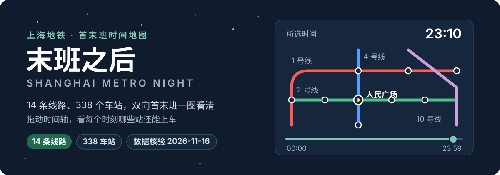
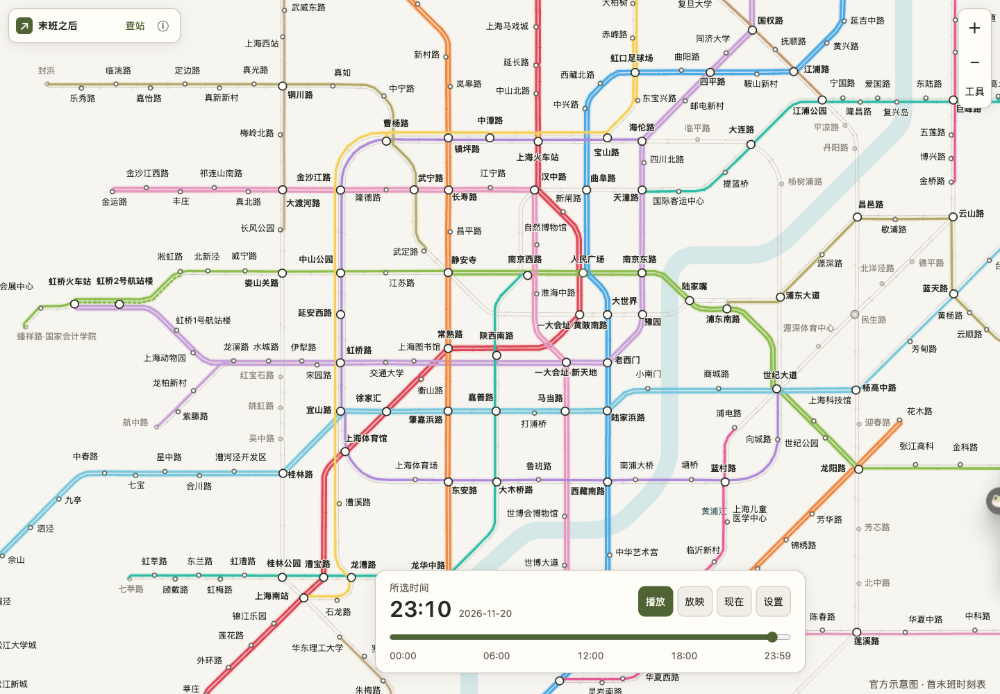
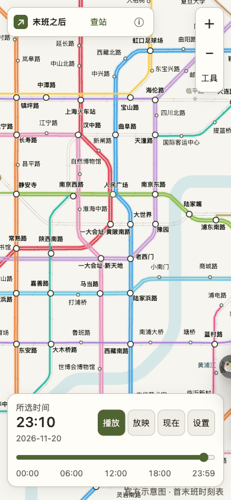

<p align="right"><a href="README.md">中文</a></p>

<p align="center">
  
</p>

<p align="center">
  <a href="https://xiaosang.cc/shanghai-metro-night/">▶ Try Online</a>
  ·
  <a href="https://github.com/holynova/shanghai-metro-night">GitHub Repository</a>
</p>

Shanghai Metro Night is a first/last-train map for the Shanghai Metro: a full-screen schematic with floating search and a timeline. Drag the time to see, for each of 14 lines and 338 stations, whether you can still board in either direction. Station layout follows the official schematic; first/last times come from official timetables.

## Screenshots

<p align="center">
  
</p>

<p align="center">
  
</p>

## Features

- **Per-direction service status**: for every station and every direction, whether a later train can still be boarded at the selected time — at a glance; gray means no later boarding service in that direction.
- **Timeline**: drag or play from 00:00 to 23:59 to watch service change through the day; 「现在」 ("Now") jumps back to the current time.
- **Station search**: a floating search box to locate any station by name.
- **Opening & closing film**: auto-plays the day's line openings and closings, fast-forwarding through quiet hours, with timed announcements when lines open or close.
- **Light / dark themes**: one-tap switch.
- **14 lines**: Lines 1, 2, 3, 4, 6, 7, 8, 9, 10, 12, 13, 14, 15, and 18 — 338 stations in total.
- **Sources page**: the in-site `sources.html` lists the official source for every line.

## About the Data

- First/last times come from official timetables; the map layout comes from the official schematic (version D202512); data verified 2026-11-16, excluding temporary service changes.
- Gray only means no later boarding service in that direction at the selected time — not that the tracks are empty, and not a transfer guarantee.
- This is a snapshot of published timetables, not live train tracking.
- An independent project, not affiliated with Shanghai Metro.

## Run Locally

Requires Node.js and Python 3:

```bash
npm ci
npm test     # 38 tests, all passing
npm run build
npm run dev  # open http://localhost:5179
```

## Tech

- Pure frontend: ES modules + SVG schematic, zero framework, zero build dependencies (the build script only imports data and checks syntax).
- Official data snapshots live in `sources/`; import scripts are in `scripts/` (`import-official.mjs`, `import-map.py`).

```
dist/index.html        Entry: full-screen map + floating search + timeline
dist/app.mjs           App logic
dist/map-data.mjs      338 station coordinates and line paths (official schematic layout)
dist/official-data.mjs First/last timetables for 14 lines
dist/schedule.mjs      Time calculations
dist/network.mjs       Network model
dist/show-plan.mjs     Opening & closing film choreography
tests/                 38 tests (model / film / timeline)
```
