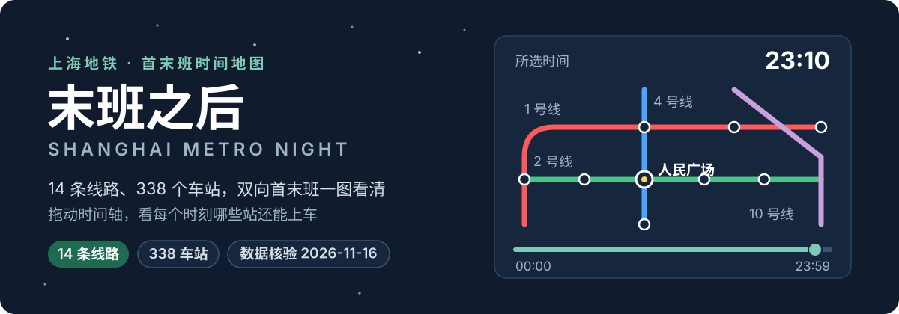
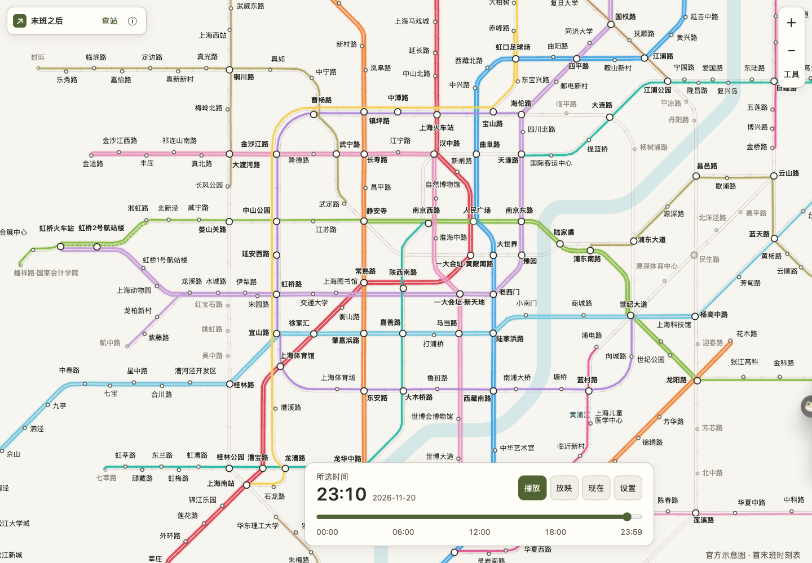
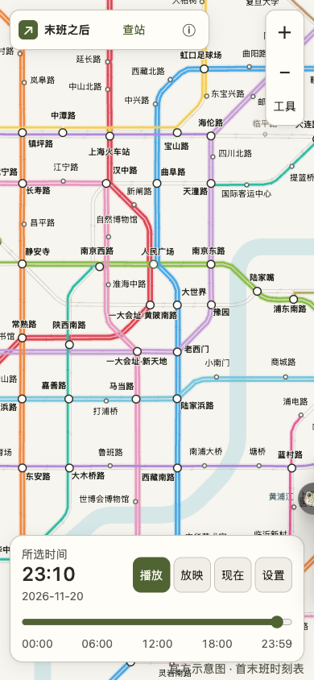

<p align="center">
  
</p>

<p align="center">
  <a href="https://xiaosang.cc/shanghai-metro-night/">▶ 在线体验 Try Online</a>
  ·
  <a href="https://github.com/holynova/shanghai-metro-night">GitHub 仓库</a>
</p>

末班之后是一张上海地铁双向首末班时间地图：全屏线路图搭配悬浮搜索与时间轴，拖动时间，看 14 条线路、338 个车站的每个方向在当前时刻还能不能上车。站点与线路沿用官方示意图布局，首末班来自官方时刻表。

Shanghai Metro Night is a first/last-train map for the Shanghai Metro: a full-screen schematic with floating search and a timeline. Drag the time to see, for each of 14 lines and 338 stations, whether you can still board in either direction. Station layout follows the official schematic; first/last times come from official timetables.

## 截图 / Screenshots

<p align="center">
  
</p>

<p align="center">
  
</p>

## 功能 / Features

- **双向服务状态**：每个车站、每个方向，当前时刻有无后续班次可上车，一目了然；灰色表示该方向当前无后续班次。
- **时间轴**：拖动或播放，从 00:00 到 23:59 看全天服务变化；支持「现在」一键回到当前时刻。
- **站名搜索**：悬浮搜索框，输入站名快速定位。
- **收发车放映**：自动播放一天的开通与收车，平稳时段自动快进，弹幕提示线路开通与收车。
- **浅色 / 深色模式**：一键切换。
- **14 条线路**：1、2、3、4、6、7、8、9、10、12、13、14、15、18 号线，共 338 个车站。
- **数据来源页**：站内 `sources.html` 列出每条线路的官方来源。

## 数据说明 / About the Data

- 首末班时刻取自官方时刻表，地图布局取自官方示意图（版本 D202512），数据核验于 2026-11-16，不含临时运营调整。
- 灰色只表示该方向当前无后续班次可上车，不代表轨道上没有列车，也不保证换乘成功。
- 这是已公布时刻表的快照，不是实时列车追踪。
- 本项目为独立作品，不隶属于上海地铁。

## 本地运行 / Run Locally

需要 Node.js 与 Python 3：

```bash
npm ci
npm test     # 38 项测试，全部通过
npm run build
npm run dev  # 打开 http://localhost:5179
```

## 技术 / Tech

- 纯前端：ES 模块 + SVG 示意图，零框架、零构建依赖（构建脚本只做数据导入与语法检查）。
- 官方数据快照保存在 `sources/`，导入脚本在 `scripts/`（`import-official.mjs`、`import-map.py`）。

```
dist/index.html        入口：全屏地图 + 悬浮搜索 + 时间轴
dist/app.mjs           应用逻辑
dist/map-data.mjs      338 个车站坐标与线路路径（官方示意图版式）
dist/official-data.mjs 14 条线路首末班时刻表
dist/schedule.mjs      时刻计算
dist/network.mjs       线网模型
dist/show-plan.mjs     收发车放映编排
tests/                 38 项测试（模型 / 放映 / 时间轴）
```

## English

**Shanghai Metro Night** maps first and last boarding times across the Shanghai Metro — 14 lines, 338 stations, both directions — on the official schematic layout. Drag the timeline from 00:00 to 23:59 and watch which stations you can still board at any moment.

- **Per-direction status**: gray means no later boarding service in that direction at the selected time — not that the tracks are empty, and not a transfer guarantee.
- **Search** any station; **light/dark themes**; a **timetable film** mode that plays the day's openings and closings with auto fast-forward through quiet hours and timed announcements.
- **Data**: first/last times from official timetables, layout from the official schematic (version D202512), verified 2026-11-16; excludes temporary service changes. A published-timetable snapshot, not live tracking. An independent project, not affiliated with Shanghai Metro.
- **Run it**: `npm ci && npm test` (38 passing) `&& npm run build && npm run dev` → http://localhost:5179. Pure frontend ES modules + SVG, zero framework.
